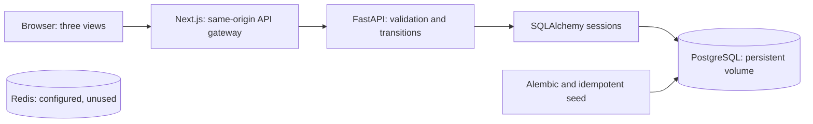
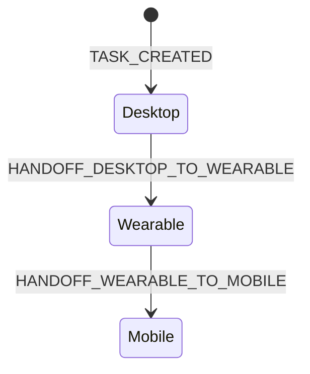

# NOVA architecture

Phase 6 adds user-controlled memory lifecycle, explicit/inferred provenance,
exact pgvector/full-text/structured retrieval with RRF, and read-only kernel
MemoryPlugin integration. See [Phase 6 architecture](phase-6-architecture.md).
Fixture embeddings are default; no cloud or real embedding model is configured.

Phase 5 adds sanitized local image ingestion, independent perception records,
VISION routing and bounded visual context for the existing agent/approval path.
See [Phase 5 architecture](phase-5-architecture.md). Fixture is the default;
no weights, real camera, cloud image traffic or permanent visual memory.

Phase 4 adds typed provider/routing contracts, optional local text compatibility,
privacy/capability/device policy, authoritative UTC budgets and model-call history,
scoped signed Redis result caching, and the Model Router UI. See
[phase-4-architecture.md](phase-4-architecture.md) and routing/budget ADRs.
No paid provider or model installation is required. Phase 3 is checkpointed at
`fd656797c60db50c60e78a163595d5ed4017a153`; Phase 4 is checkpointed at
`5a4cec77641da80f98976ab258f2f18aa011bf0e`; Phase 5 is checkpointed at
`8c5e2b80a305779be1723ddded750424064ff30e`. Phase 6 remains uncommitted.

Phase 3 adds deterministic proactive triggers, Redis cooldowns, communication
drafts, payload-bound human decisions, and pure simulated execution. See
[phase-3-architecture.md](phase-3-architecture.md) and the approval/Redis ADRs.
PostgreSQL remains authoritative; no real external communication occurs.
Phase 3's approval invariants remain unchanged by model selection.

Phase 2 extends the Phase 1 foundation below with persisted multi-agent
intelligence. See [phase-2-architecture.md](phase-2-architecture.md) for the
current agent contracts, Semantic Kernel boundaries, plugin architecture,
execution protocol, failure policy, and intelligence UI. The task model and
continuity APIs remain the shared foundation; there is no parallel AI task system.

The Phase 1 checkpoint is local commit
`d1d80d687171e992c963e92c797ec924ba815cb5`. Its implementation and closed F-01
finding are preserved in that commit. Phase 2 is checkpointed at `1cecd1b276887241d5e46c77159f76f85cc14bd7`.

## Scope and system boundary

Phase 1 is the NOVA Core / Cross-Device Continuity foundation. It proves
persistent task ownership across simulated device contexts using real backend
state. The database is the authority. The frontend renders confirmed API
responses and never invents task transitions, agent execution, or model metrics.

## Data model

All IDs are PostgreSQL UUIDs. Timestamps are timezone-aware. Pydantic serializes
timestamps and UUIDs for the REST API. Tasks and events are written in the same
transaction.

| Table | Columns |
| --- | --- |
| `users` | `id` PK, `name` varchar(100), `created_at` |
| `devices` | `id` PK, `user_id` FK → users, `name` varchar(100), `type` varchar(20), `created_at` |
| `tasks` | `id` PK, `user_id` FK → users, `title` varchar(240), `description` text, `origin_device_id` FK → devices, `current_device_id` FK → devices, `status` varchar(20), `created_at`, `updated_at` |
| `task_events` | `id` PK, `task_id` FK → tasks, `event_type` varchar(64), nullable `source_device_id` FK → devices, `target_device_id` FK → devices, nullable `idempotency_key` varchar(128), `metadata` JSONB, `sequence` integer, `created_at` |

The additional per-task `sequence` guarantees event ordering even when database
timestamps tie. SQLAlchemy reserves the attribute `metadata`, so the ORM uses
`event_metadata` while the SQL column and JSON response retain `metadata`.
Metadata contains the originating request correlation ID, not hidden AI state.

Constraints and indexes:

- All required columns are non-null. Names and titles must be nonblank.
- Device type is limited to DESKTOP, WEARABLE, MOBILE; `(user_id, type)` is unique.
- Task status is ACTIVE. No completion API is implemented in this phase.
- Event type/key combinations are constrained: creation has no key; a handoff
  has a key and one of the two supported event types.
- `(task_id, idempotency_key)` is unique. PostgreSQL permits multiple nulls,
  allowing creation events without handoff keys.
- `(task_id, sequence)` is unique.
- Indexes cover devices by user, tasks by user/creation time, tasks by current
  device, and events by task/creation time. Unique sequence/key indexes support
  ordered event reads and retry lookups.
- Foreign keys preserve references; no deletion endpoints or cascading deletes
  are implemented.

The server always resolves the fixed demo user. Ownership validation happens in
the application before creation or handoff. Phase 1 is not an authorization
system for multiple signed-in users.

## Demo identity

The idempotent seed uses fixed UUIDs and PostgreSQL `ON CONFLICT DO NOTHING`.
Repeated service starts do not create additional devices or overwrite tasks.

| Context | Device UUID |
| --- | --- |
| Desktop | `00000000-0000-4000-8000-000000000010` |
| Wearable | `00000000-0000-4000-8000-000000000020` |
| Mobile | `00000000-0000-4000-8000-000000000030` |

Demo user: `00000000-0000-4000-8000-000000000001`. No task is seeded; tasks
are created through the real API.

## Transition protocol

Creation validates that the origin belongs to the demo user and is Desktop,
then inserts one task and one event before committing. Handoffs update only
`current_device_id` and `updated_at`; they never insert another task.
The task remains ACTIVE on Mobile after the continuity path is complete.

Each handoff supplies source, target, and an idempotency key:

1. Select the owned task with `SELECT ... FOR UPDATE`.
2. Look up an existing `(task_id, idempotency_key)` event.
3. If the key exists with identical source and target, return that event and
   current task state with `replayed=true`. Do not mutate anything.
4. If the key exists with different source or target, return HTTP 409.
5. Validate owned devices, source equals current device, and allowed transition.
6. Update the existing task and insert its next event in one transaction.
7. Commit, release the row lock, and return `replayed=false`.

Retries are intentionally checked before current-device validation. A retry of
Desktop → Wearable after a later Wearable → Mobile handoff remains valid and
cannot roll the task backward. The unique key constraint is a second defense
against duplicate events. Different tasks may use the same key.

Concurrent requests to the same task serialize at the row lock. Identical-key
requests produce one event and replay acknowledgments. Different-key requests
for the same source produce one transition and a stale-source conflict. Tests
exercise both cases with multiple threads against PostgreSQL.

This provides one committed transition per key, not guaranteed delivery.
Clients must preserve a key across an uncertain response. The UI keeps a
pending handoff key in localStorage where available; it stores **request intent
only**, never authoritative task state. Event-history retry buttons use keys
read from the backend. Task creation does not offer idempotency in Phase 1.

## Frontend behavior

- `/`: Command center lists active tasks, selected current context, recorded
  handoffs, and recent events for the selected task.
- `/continuity?task=UUID`: Device continuity shows the three contexts and offers
  the next valid handoff. A selector chooses among loaded tasks.
- `/tasks/UUID`: Task detail displays identity, origin, current context, status,
  timestamps, description, full events, and original-handoff retry actions.

Selection is encoded in the URL, so refresh preserves the chosen task. Initial
reads, manual refresh, window focus, and a 15-second visible-page interval fetch
backend state. No optimistic transition is shown before backend confirmation.
Failed connections display an offline state and block mutations; previously
loaded data is labeled stale until a successful reload. Loading and empty
states do not display invented task records.

Next.js proxies `/api/v1/*` to FastAPI server-side with timeouts, no-store caching,
and propagated correlation IDs. This avoids browser CORS configuration and
keeps the internal backend hostname out of browser configuration. It does not
provide authentication. The technical visual system uses graphite panels,
thin borders, system fonts, and a restrained green accent; no downloaded fonts
or imagery are required.

## Lifecycle, observability, and cost

Alembic applies explicit versioned schema changes; application startup does not
call `create_all`. Seeding follows migration before FastAPI starts. PostgreSQL
uses a named volume that survives container replacement and normal shutdown.

Liveness is process-only. Readiness requires database connectivity, the migrated
task table, and three seeded demo contexts. Redis is not on the application
readiness path because the application does not depend on it.

Backend application/request logs are JSON with a timestamp, level, message,
correlation ID, and applicable request path/status/latency or task ID. Incoming
correlation IDs are bounded and restricted to safe characters; invalid IDs are
replaced. Request bodies and task text are not logged. Logs are emitted to
stdout/stderr for local `docker compose logs`. No OpenTelemetry is implemented.

No AI provider is implemented in this phase, and there is no paid API execution
path. Future AI work must follow the provider abstraction, fixture testing,
budget, and replay requirements in the root `AGENTS.md`.

## Technical decisions and references

Each dependency serves this phase: Next.js provides the UI/server gateway;
FastAPI and Pydantic provide the typed API; SQLAlchemy/psycopg provide PostgreSQL
transactions; Alembic versions schema changes; Docker Compose reproduces the
local stack. Redis is configured because it is part of the requested stack,
with application usage deferred until justified.

Implementation follows the official [Next.js installation guidance](https://nextjs.org/docs/app/getting-started/installation),
[FastAPI lifespan guidance](https://fastapi.tiangolo.com/advanced/events/), and
[SQLAlchemy ORM query API](https://docs.sqlalchemy.org/en/20/orm/queryguide/api.html).
The implementation uses no Sites hosting or cloud resources.

## Deliberate limitations

Single local demo user; simulated device contexts; ACTIVE status only; forward
handoffs only; up to 100 tasks loaded by the UI; polling rather than push
notifications; no creation idempotency; no pagination controls in the UI; no
authentication or external calendar/messages. There are no agents, LLM/VLMs,
RAG, memory, Kafka, Go services, cloud provisioning, Kubernetes, Terraform,
bandits, or full telemetry in Phase 1.
