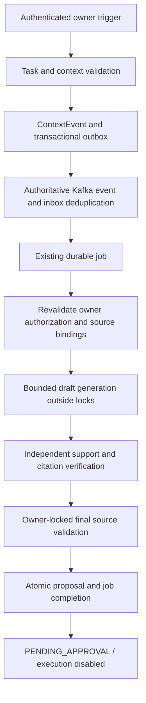

# Phase 10 owned evidence drafts

Baseline: Phase 9 checkpoint `7765b33736c28ccc560fc8269bb5fc4b9b050518`.
Scope: privacy-first bounded recommendations, stopping at pending human approval.
External actions, new tools, new models and broader agent reasoning are excluded.

## Reuse and bounded contract

The existing proactive API/service, ContextEvent, ProactiveTrigger, ActionProposal,
ApprovalDecision, AuditEvent, transactional outbox/inbox and event Job are reused.
No new agent framework, broker, database table or migration is introduced. Existing
Context/Planner/Calendar/Memory/Critic orchestration and synthetic meeting demo keep
their contracts. This new workflow is a specialized bounded draft agent using the
existing InferenceProvider abstraction, rather than promoting the full planner to
an unqualified 96-token real-model contract.

The owner explicitly submits a task, a named-subject cuisine/beverage preference
question and optionally one or two existing memory IDs. Without IDs, bounded
structured retrieval selects matching eligible facts for the named subject and
predicate; sources outside those keys are not used. Submission opts into that single
request for 30–600 seconds; it does not subscribe the owner to background profiling.
The references are retrieved by ID under the Phase 9 eligibility query. Only the
declared named-subject preference subset is supported. Unknown, first-person,
visual, unrelated, oversized, duplicate-reference and conflicting contexts refuse.
Retrieval scores and language-model judgments do not grant sufficiency.

Every source must be ACTIVE, owned, USER-scoped or bound to the same TASK, within
validity dates and INTERNAL/PERSONAL. Source snapshots preserve original UUID,
normalized full text, subject/predicate/value, origin and Phase 9 binding digest.
These are private application records, never public prompts or event bodies.
Access and finalization revalidate current bindings and fresh relevant conflicts.
Stored facts are not certified true; exact extractive support is not general
semantic entailment. The existing unsafe-content markers are narrow refusal rules,
not a complete natural-language injection detector. The agent has no action tools.

## Durable lifecycle

Request keys are task-scoped and payload-hashed; changed intent conflicts.
ContextEvent insert emits one metadata-only event. State updates do not emit new
draft-trigger events. Only an authoritative outbox event with matching task/owner
can create a job; duplicate delivery shares its existing unique event_id job.

The existing PostgreSQL session advisory lock admits one worker across processes.
Generation occurs outside the owner transaction. Final context checks, proposal,
job result and audit write commit together under the existing owner mutation lock;
source and identity/device rows are locked through acceptance. Cancellation can
win during generation; a late completion cannot resurrect a terminal request.
Fixture work can recover RUNNING jobs after a crash. A real RUNNING request with
ambiguous prior execution fails closed rather than generating again. Known model/
schema/verification failures terminate the draft; unexpected infrastructure errors
retain existing bounded job backoff. Retry cannot reactivate terminal context.

State: QUEUED -> RUNNING -> PENDING_APPROVAL; cancellation, expiry, failed
verification and rejection are terminal. Pending sources are revalidated on reads
and expire when no longer eligible. The dedicated draft view removes content and
evidence for terminal requests. Legacy proposal detail/list views also redact stale
Phase 10 content. Original private evidence remains in historical database records;
this is not physical erasure or a retention-policy implementation.

REQUESTED and EVIDENCE_VERIFIED are audit milestones rather than extra durable
states: request receipt shares the queue/outbox transaction, and evidence
verification shares the final proposal/job transaction. Owned-draft audit events
use the existing SystemClock; legacy demonstration audits keep their fixture clock.
The timestamp/milestone correction and expanded lifecycle assertions passed
current-source qualification. R1 subsequently failed during real Qwen loading at
the swap gate; its terminal FAILED/DEAD outcome remains preserved. Device enrollment
recovery preserved the original owned enabled version-1 Desktop registration.
Final full qualification after controller safety corrections passed without real
models. Separately authorized R2 then passed with one generated supported value,
verified original citation and current source/privacy/permission bindings, one DONE
job and one PENDING_APPROVAL proposal without approval/execution. Phase 10 is
COMPLETE in this bounded local scope; credentials revoked, real settings disabled
and all task services/models stopped. No additional inference is authorized.

## Authorization and provider boundaries

HTTP uses existing local/OIDC authentication and RBAC, followed by task ownership.
The Principal now carries the verified identity-row ID for server-side permission
binding. Real local/OIDC requests bind identity version, owner role and device
registration version. Queue processing and finalization recheck revocation; the
worker's synthetic owner principal cannot replace those saved grants. Demo mode
remains explicitly fixture identity, not proof of authenticated hardware ownership.

FIXTURE is the default and uses existing GroundedFixture generation and strict
GroundedOutput validation, then checks each original UUID/full quote independently
against the query/source contract. Tokens are UNKNOWN when not reported.

Private `OWNED_DRAFT_MODE=LOCAL_REAL` is prepared but not enabled by this phase.
It requires the existing approved private LocalProvider configuration, managed
residency and SELECTION_V1. It passes only bounded subject/predicate/value indices
and verifies the model's exact supported value before attaching original UUID/text.
The pinned context-budget profile is checked by LocalProvider before acquisition.
No API parameter selects a provider, model, endpoint or authority. Invalid/disabled
modes refuse generation; historical reads and cancellation remain available.

The real path preserves the existing startup 30s/inference 8s distinction and
finally-based lease release. Fixture generation has an 8s bound. No cloud fallback,
download or real retry is introduced. Full arbitrary agent plans are not qualified.

Phase 10 proposals use LOCAL_RECOMMENDATION and policy OWNED_CONTEXT_V1. Approve,
edit and execute are refused by the existing mutation service for this contract;
rejection uses an existing ApprovalDecision. Cancellation marks the proposal
REJECTED, with a separate CANCELLED request/audit state. No ActionExecution is
created. Historical communication simulation APIs remain available for their
original tests and do not become Phase 10 execution capabilities.

## API and interface

- POST `/api/v1/proactive/drafts`: explicit task/query/memory_ids/idempotency key.
- GET `/api/v1/tasks/{task_id}/drafts`: latest 50 owned requests.
- GET `/api/v1/proactive/drafts/{id}`: current state, verification and evidence.
- POST `/api/v1/proactive/drafts/{id}/cancel`: durable owner cancellation.
- Existing proposal detail/reject routes and operations/job/outbox views are reused.

Approval Center adds an owned-draft panel, evidence, purpose/status, expiry,
failure, cancellation and rejection. Draft proposals have no approval/execution
buttons. Suggested, pending and completed historical simulation labels stay
distinct. Model mode is server-reported; the UI never authorizes a model load.

## Remaining qualification

Deterministic tests and local Kafka/browser execution qualify the specified local
fixture workflow. One subsequently authorized R1 real attempt failed when swap
exceeded 2048 MiB during Qwen loading, with no completed response observed. Successful
real draft acceptance, model instruction following, general proactive usefulness
and broader agent orchestration remain unverified.
See the implementation audit and separately scoped acceptance proposal. Phase 9
measurements and completion scope are preserved. No Phase 11 work is included.

R1 diagnosis: read-only SQL confirmed one FAILED request/DEAD job and zero
proposals/decisions/executions. The residency controller now persists transitions,
retains failed resource measurements and records termination before propagating an
unsafe final snapshot. An unwritable record still fails closed and poisons
acquisition after process cleanup. No safety ceiling or application contract changed.
R2 proposes serial queue/model stages with only PostgreSQL and the jobs worker
during inference; jobs-mode does not open a Kafka connection. This proposed topology
and new controller have focused offline coverage, not real-model qualification.
See the unapproved R2 proposal for exact headroom, hashes, request and limits.

Final current-source qualification passed 750 backend/one real skip, 17 controller,
Go/frontend/browser/Kafka/golden checks. The staged PostgreSQL/jobs-only topology
also passed a separate actual FIXTURE test with broker/API/Redis stopped. It does
not qualify Qwen loading or remove R2's <1024 initial swap/approval boundary.

## R2 operational acceptance closure

The staged R2 plan was executed once: Kafka created the durable job, then only
PostgreSQL and the jobs worker remained during Qwen generation. BGE stayed disabled.
The model generated `noodles` at index 0; independent support, original UUID/full
quote, final source/privacy/conflict and current authorization checks passed.
One pending proposal required approval; no ApprovalDecision or ActionExecution
was created. All existing context/output/CPU/memory/deadline ceilings were preserved.
The final audit records measurements and retained limits. Earlier proposal/fixture
readiness statements are historical; R2 approval is now consumed and closed.
Cleanup revoked temporary credentials and invalidated their saved grant binding;
acceptance-time pending state does not authorize subsequent use under revoked grants.
