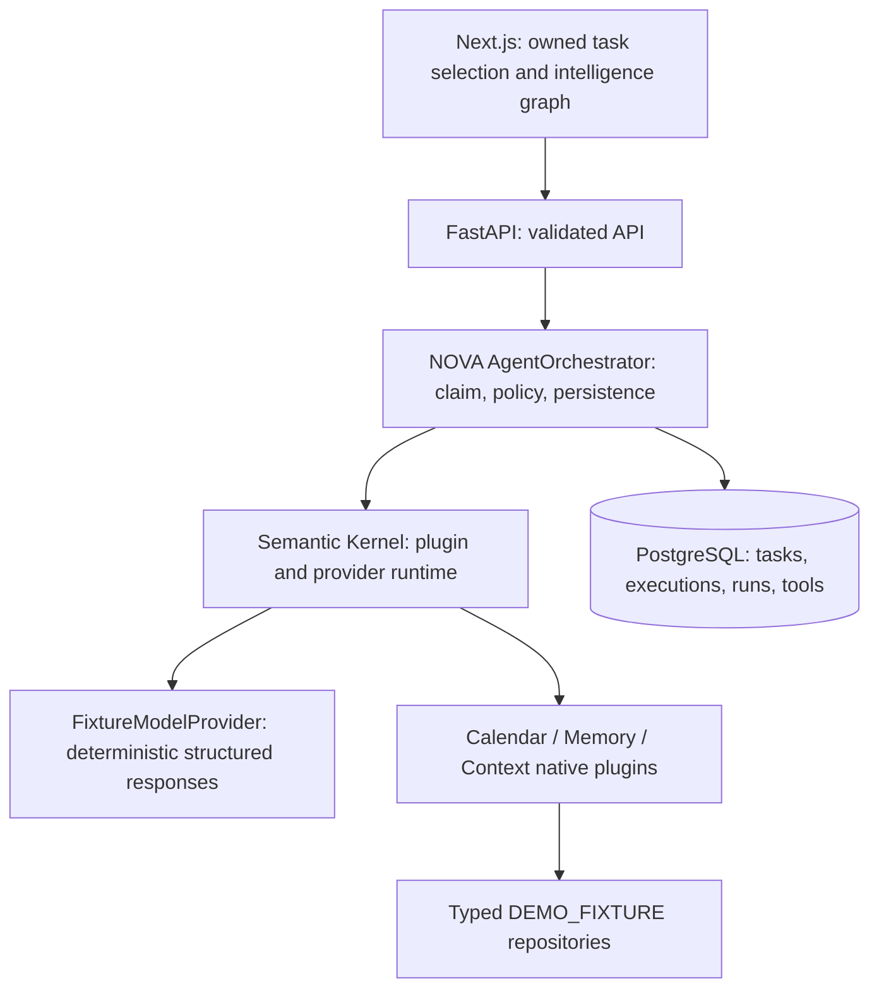
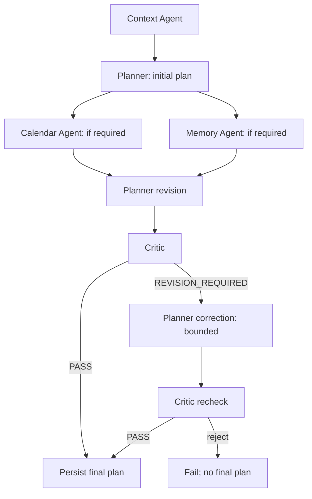

# Phase 2: multi-agent core

Phase 2 adds actual deterministic orchestration and persistent agent/tool traces
to the existing task. It preserves the Phase 1 task UUID, handoff protocol,
idempotency, and closed F-01 selection safeguards. Everything runs locally with
no external API key, paid inference, cloud deployment, or model download.

## Boundaries and responsibilities



Semantic Kernel owns plugin registration, function discovery/metadata,
controlled native invocation, provider service registration/resolution, and
bounded invocation arguments/metadata. NOVA owns authorization, persistence,
task state, idempotency, dependency ordering, critical failure handling, API
validation, and deterministic plan policy. It does not use the kernel as a
database or authorization layer. See the [ADR](adr/0001-semantic-kernel.md).

## Provider and agent contracts

`ModelProvider` is an abstract kernel AIServiceClientBase service with
`provider_name`, `model_name`, `capabilities`, and async `generate_structured`.
The only configured implementation is FixtureModelProvider (`nova-demo-v1`).
Its response envelope identifies the provider and DEMO_FIXTURE source and
contains structured JSON validated against the receiving agent's Pydantic
contract. It is **not an LLM**. Commercial/local/reasoning adapters are future
implementations of this interface, not present services or test dependencies.

`AgentInput` carries task/user UUIDs, captured current device, goal, typed
SharedContext, typed prior results, context requirements, trace UUID, and
revision number. Successful `AgentResult` contains agent/status, summary,
discriminated typed output, tool references, evidence/provenance, warnings,
and actual timestamps. Failures raise to the orchestrator and are recorded
as FAILED AgentRun rows; there is no invented successful result.

Structured outputs are ContextOutput, CalendarOutput, MemoryOutput, PlanOutput,
and CriticOutput. A Plan includes goal, assumptions, attributable constraints,
steps, required tools, missing information, and approval requirement. Critic
returns PASS or REVISION_REQUIRED with structured reasons and never edits the
plan. Planner owns every revision. Python mappings are limited to indexes,
SDK/JSON boundaries, and serialization; shared agent context is typed.

## Five agents and graph



- Context identifies needed calendar/person/preferences/location information
  and retrieves the simulated device and, when required, demo location context.
- Planner creates the initial structured plan and identifies required tools.
- Calendar retrieves meeting evidence through CalendarPlugin.
- Memory retrieves only explicit synthetic preferences through MemoryPlugin.
- Planner revises after specialist evidence is merged into SharedContext.
- Critic checks unsupported assumptions/provenance, missing context, goal
  conflicts, unnecessary actions, and approval/privacy requirements.

Specialists form one dependency level and run through `asyncio.gather`; sequence
numbers provide a stable display order, not a fabricated dependency between
Calendar and Memory. Skipped specialist/revision stages have persisted SKIPPED
records and no invocation. A generic checklist needs Context, Planner, and
Critic only; no calendar or memory lookup is invented.

A Critic rejection permits one additional Planner correction and Critic recheck.
Persistent rejection fails the execution. A provider's claimed PASS cannot
bypass deterministic application review of evidence, provenance, task goal,
and approval boundaries. Structured output is treated as untrusted input.

## Plugins and synthetic source

| Plugin | Explicit functions |
| --- | --- |
| CalendarPlugin | `get_events_for_date`, `find_events_related_to_task` |
| MemoryPlugin | `get_preferences_for_person`, `get_user_preferences` |
| ContextPlugin | `get_device_context`, `get_demo_location_context` |

All plugins use the centralized typed `app/fixtures/personal_context.py`
repository. Their capabilities are read-only and bounded; no filesystem,
shell, unrestricted SQL session, HTTP client, or generated code is exposed.
KernelRuntime enforces a per-agent plugin/function allowlist before invoking
the registered kernel function. Planner and Critic have no tool capabilities.

The synthetic dinner context is Product Review tomorrow, 16:00–17:00, Downtown;
Sarah's explicit Italian preference; dinner after 18:00 preference; and a
simulated meeting-end location near Downtown. Each fact contains DEMO_FIXTURE
provenance; preferences identify `explicit_preference`. "Tomorrow" is a fixture
relative-date label, not access to a real calendar or an inferred live date.

The UI labels this as DEMO CONTEXT / FIXTURE / DETERMINISTIC / NOT AN LLM.
It displays no real restaurants, booking, contact lookup, message sending,
inference tokens, or invented model metrics. Unknown availability and actual
restaurant options remain explicit missing information.

## Persistent execution protocol

Migration `0002_intelligence` adds:

| Table | Purpose |
| --- | --- |
| `agent_executions` | Task-level execution UUID/trace, provider/model, status, key, timestamps, context, critic result, final plan, safe error code |
| `agent_runs` | Per-stage agent, sequence, trace, status, timestamps, summary, typed serialized output, evidence, warnings, safe error code |
| `tool_calls` | Kernel plugin/function invocation, agent/trace references, bounded inputs/outputs, status, timestamps, safe error code |

UUID foreign keys attach all intelligence to the original task. Unique
`(task_id, idempotency_key)` claims prevent repeat execution. A partial unique
task index allows only one RUNNING execution per task. Agent sequences are
unique within an execution. Checks constrain persisted statuses.

The orchestrator briefly locks the owned task to claim an execution, snapshot
the goal/device, and create WAITING stage rows. It then releases that task lock
before running any agent. Each stage transition and tool record is persisted
in a short transaction, so another request can observe real progress and hand
off the task without waiting for the entire execution. Agent completion never
rewrites task device ownership.

Exact-key repeats return the original execution, including RUNNING or FAILED
state. A competing new key during a RUNNING execution returns HTTP 409.
After completion/failure, an explicit new key can start a new execution; older
history remains accessible. GET plan selects the latest execution and exposes
a final plan only after Critic PASS and successful completion.

Critical failure records the failed stage/tool, skips dependent stages, and
stores execution FAILED. Malformed provider output cannot publish a plan.
Interrupted RUNNING executions are marked FAILED/APPLICATION_RESTARTED during
single-process startup rather than silently resumed or claimed successful.

## API and frontend lifecycle

```text
POST /api/v1/tasks/{id}/run-agents
GET  /api/v1/tasks/{id}/agent-runs
GET  /api/v1/tasks/{id}/agent-runs/{run_id}
GET  /api/v1/tasks/{id}/plan
```

POST requires a validated idempotency key. A new execution returns HTTP 201;
an original-key replay returns HTTP 200. Both return `{execution, replayed}`;
execution status, not an invented response, communicates failure. The
X-Trace-ID response header and execution body identify the persisted trace.
An unknown/unowned task or mismatched agent-run task returns HTTP 404.
All Phase 1 routes remain unchanged.

`/intelligence?task=UUID` shows a selectable execution graph, node statuses,
sequence, summary, evidence, tool records, structured output, duration, provider,
discovered context, critic result, and final plan. Task Detail embeds the same
intelligence view. The graph before execution is labeled a workflow blueprint;
DONE/RUNNING/FAILED/SKIPPED come from persisted AgentRun records.

The parent Phase 1 selection owner gates intelligence mutations before router
navigation commits. The intelligence component is keyed to the validated task
UUID, aborts superseded reads, checks request generation and response task ID,
and ignores completions after unmount/selection change. A synchronous posting
guard prevents duplicate clicks. A localStorage entry stores only request-key
intent; a refresh or lost acknowledgment retries the original key, not a new
execution. Task/plan state is always read from FastAPI, never browser storage.
Visible-page intelligence reads poll every two seconds; the fixture workflow
often finishes too quickly to expose intermediate stages in the UI. No artificial
delays or animated fake execution sequence are added.

## Trace, security, cost, and limitations

Each execution UUID is also its trace UUID. Agent runs, tools, application logs,
response bodies, and POST headers carry that trace. Execution-start logs link
it to the request correlation ID. This uses explicit structured logging and
database fields; NOVA configures no full OpenTelemetry pipeline or exporters.

Task text is omitted from stored CalendarPlugin input records. Tool outputs
contain only bounded synthetic data. Raw provider exceptions/payloads are not
stored in failure records; safe error codes are used. The existing task text
and validated plan goal remain part of task/plan persistence by design. Do not
enter secrets into the local demo's task text.

The mandatory Semantic Kernel distribution includes cloud-client and telemetry
SDK packages. They are pinned in the dependency constraints but not configured,
instantiated as providers, or exposed as plugins. Tests block commercial client
and credential construction/external async HTTP paths during fixture orchestration.
No paid service, hosted infrastructure, external personal-data access, or model
download is required. The production stack remains the same local Compose stack.

Limitations: unauthenticated demo user, no distributed worker queue, one local
application process for startup recovery, synchronous short-running execution,
polling, fixture-specific context/rules rather than general model reasoning,
forward-only device handoffs, and no public-deployment security certification.
Agents/plugins/context are typed application abstractions, not OS-process
sandboxes. Future services require explicit trust and lifecycle design.

Phase 3+ capabilities (real models/tools, restaurant search, OAuth, VLMs, vector
memory, Kafka, Go, Terraform/Kubernetes, notifications, and full observability)
are not implemented.
