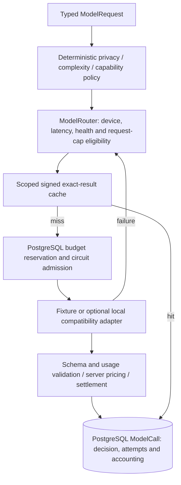

# Phase 4: model intelligence, routing, budgets and optional local inference

Phase 4 extends Phase 3 checkpoint `fd656797c60db50c60e78a163595d5ed4017a153`
without replacing shared tasks, Semantic Kernel plugins, deterministic policy,
or the human approval/execution services. Fixture operation remains complete
without keys, model downloads, inference software, or paid services.

## Baseline model-layer audit and responsibility

The existing ModelProvider is a real kernel AIServiceClientBase abstraction.
FixtureModelProvider produces bounded application structures; agents validate
those structures and use native kernel plugins. Before Phase 4 it had no
provider routing, usage/cost contract, model-call ledger, cache, health, circuit,
or budget enforcement. Phase 3 already kept drafting separate from authorization
and committed approvals and simulated receipts in PostgreSQL.

The new `app/model_routing` module adds typed contracts, InferenceProvider,
provider registry, ModelRouter, BudgetPolicy, ResultCache, Circuit, durable
ModelCall/BudgetDay records, APIs, and a RoutedModelProvider kernel facade.
The old provider methods and all default Phase 1–3 paths remain unchanged.
No agent constructs a vendor client or chooses a provider.



## Typed contracts and provider boundary

ModelRequest owns request/task/trace/user UUIDs, purpose, TEXT-only modality,
bounded structured input (32 KB), capabilities, privacy, complexity, latency,
captured simulated device, output-token cap, mode and schema version. API clients
submit a task, request UUID and a server-defined scenario; they cannot submit
provider URLs, credentials, user identity, selected providers, prices, approval,
or arbitrary router metadata. The public demo does not accept arbitrary prompts.
The routed agent facade accepts the existing typed AgentInput programmatically.

ProviderSpec declares identity, logical tiers, TEXT/STRUCTURED/REASONING or
REASONING_REPLAY capabilities, enablement, context/output limits, latency class,
strength, external-price status and optional typed Price. Tiers include FIXTURE,
SMALL, FRONTIER, REASONING, VISION and LOCAL; VISION is reserved, with no vision
request or inference implementation. Strength/latency declarations are server
configuration, not measured hardware or quality benchmarks.

ProviderResult permits validated output, finish reason and usage counts/provenance;
it has no routing, approval, privacy or price authority. ModelResponse adds the
server-owned decision, selected provider/tier, measured latency, usage, configured
estimated cost, cache/fallback status and normalized failure. Output schemas are
TextOutput or the existing ContextOutput/PlanOutput/CriticOutput/CommunicationOutput.
Unexpected output fields, oversized response bodies, invalid schemas, wrong model
identity, negative/non-integer tokens and counts over configured bounds fail safely.
No complete provider payload or exception is passed to the frontend.

## Providers, compatibility and optional configuration

FixtureInferenceProvider wraps the existing FixtureModelProvider for structured
agent/draft operations and supplies synthetic summary/reasoning replay templates.
It is deterministic, NOT AN LLM, reports UNKNOWN tokens, and has $0 API spend.
It does not pretend to possess real reasoning quality. Fixture reasoning is an
explicit fallback exception labeled REASONING_REPLAY_LIMITATION.

LocalOpenAICompatibleProvider implements a generic text JSON
`/v1/chat/completions` transport, plus bounded `/v1/models` health checks. It does
not depend on Ollama software, a vendor SDK client, or a particular model.
See the [documented compatibility example](https://docs.ollama.com/api/openai-compatibility)
for the protocol shape; NOVA does not use the documentation's cloud examples.
Only the exact configured model ID is eligible; no model is pulled or installed.

```dotenv
LOCAL_MODEL_ENABLED=false
LOCAL_MODEL_BASE_URL=http://host.docker.internal:11434/v1
LOCAL_MODEL_NAME=
LOCAL_MODEL_REASONING_CAPABLE=false
LOCAL_MODEL_TIMEOUT_SECONDS=8
MODEL_CACHE_TTL_SECONDS=300
DAILY_AI_BUDGET_USD=0
MAX_REQUEST_COST_USD=0
ALLOW_PERSONAL_CLOUD=false
```

To use an **already installed, already running** compatible local model, explicitly
set enablement, URL and exact model name. Compose passes these local settings.
For native backend operation, use loopback (for example localhost rather than
the Docker host alias). An optional LOCAL_MODEL_API_KEY SecretStr is supported
for a trusted local endpoint; it is not required or shown by APIs, and can be
provided through a private server environment/Compose override. No key example
contains a credential. Reasoning capability must be manually declared.

No local runtime was configured in this implementation session. Disabled mode
constructs no HTTP client, probes no ports, and performs no endpoint detection.
Real local inference acceptance is optional and was not claimed or benchmarked.
NOVA never installs software, launches an inference runtime, downloads weights,
or invokes a cloud CLI. CloudOpenAICompatibleProvider remains architecture only;
there is no configured production paid transport or cloud client.

Health is request-driven and cached for 60 seconds, with a two-second maximum
health timeout, last checked time, and AVAILABLE/UNAVAILABLE/DEGRADED/DISABLED
states. There is no background health worker. Body reads enforce an elapsed deadline
as well as HTTP per-operation timeouts; a pending I/O operation can take up to
one additional per-operation timeout before that deadline is observed. A missing model disables the
adapter; failure invalidates health conservatively rather than immediate retry.
Configured endpoints must use http/https and loopback or `host.docker.internal`,
with root or /v1 path and no URL credentials/query/fragment. Redirects and ambient
HTTP proxies are disabled. Public/cloud/metadata addresses and request-time URLs
are rejected. Configuration remains a trusted operator boundary: NOVA cannot
attest that a local compatibility server never relays to a cloud model. Known
`:cloud`/`-cloud` model identifiers are rejected; operators must configure an
actual local runtime/model. Invalid endpoint configuration fails closed.

## Deterministic routing and fallback

Privacy classes: PUBLIC, INTERNAL, PERSONAL, SENSITIVE_LOCAL_ONLY. The default
floor is INTERNAL; planning, critique, context, communication and schedule/
meeting/preference/Sarah markers raise it to PERSONAL. Explicit sensitivity or
obvious private-key/password/social-security/medical-record markers raise it to
SENSITIVE_LOCAL_ONLY. Client declarations cannot lower this inferred floor.
These rules are not an ML classifier or comprehensive PII detector.

Complexity LOW/MEDIUM/HIGH/REASONING is explicit/purpose-driven. Planning raises
LOW to MEDIUM; explicit reasoning capability, critique, reconciliation, and travel-constraint context require
REASONING. The reason is persisted. LOW/MEDIUM favor eligible local capacity;
HIGH/REASONING prefer the strongest eligible declared capability. A fixture is
always behind eligible non-fixture providers and is clearly limited replay.

SENSITIVE_LOCAL_ONLY excludes every cloud/priced-external candidate, including
fallback. PERSONAL requires explicit server policy before cloud eligibility.
No cloud provider exists in the default registry, regardless of budget settings.
Privacy/capability/availability are rechecked before each fallback; providers get
copies of requests, never the authoritative routing context. Bounded, unique
candidate chains prevent fallback loops. No eligible route returns a controlled
failure. Reason codes explain exclusions, primary preference, downgrade,
fixture limitation, cache hit and actual fallback.

Device policy is simulated: Desktop permits higher local compute; Mobile permits
LOW/MEDIUM local requests; Wearable uses limited fixture/replay eligibility.
This is not real hardware detection or on-device execution. Optional inference
physically runs on the developer's configured local host. FAST latency excludes
SLOW-declared providers; no latency/quality classifier or hardware benchmark is
invented. Original-request acknowledgment retains its captured device even if
the task has moved; a new request captures its new device.

## Token, cost and budget accounting

PROVIDER_REPORTED requires bounded integer counts from the compatibility response,
including a consistent total. LOCAL_ESTIMATED is represented for future reliable
estimators, but no tokenizer or estimator is implemented. Missing counts remain
UNKNOWN/null. Fixture tokens are unknown; cache hits have no fresh token usage
and no provider-call latency, rather than re-counting cached tokens.

Price is typed server configuration: input/output USD per million, currency,
effective date and source. No current commercial tariff is hardcoded. The only
built-in price is an explicitly synthetic **test-policy** price. Unknown pricing
produces COST_UNKNOWN/null and blocks priced invocation when a safe reservation
cannot be established. Fixture costs are zero API spend; local response costs are
null/LOCAL_COMPUTE_NOT_PRICED ($0 external API spend, compute/electricity unpriced).
Cache hits identify CACHE_NO_API_SPEND. CONFIGURED_ESTIMATE is an estimate from
configured prices and validated reported tokens, not a billing statement.

Every CLOUD declaration is budget-protected even if its optional priced flag
is omitted or false.

BudgetPolicy reserves the full declared input-context bound plus capped output
cost before a priced call. The adapter/protocol must enforce those declared
limits; the local adapter bounds encoded input and output and is not priced.
Per-request enforcement includes already-accounted exposure from earlier fallback
attempts, so individually affordable calls cannot accumulate past the cap.
Daily consumed/reserved exposure uses PostgreSQL row locking, not Redis.
Budget day is UTC and retained on reservations across midnight. Currency values
use Decimal and conservative rounding. Fixture/local are not blocked by zero
API-spend budgets. Configuration is bounded by the repository's $25 ceiling.

On success, reservation settles to the configured estimate. Timeout/unknown
usage/failure conservatively retains the full reserved exposure: a failed call
might still have been billed. UI calls this **accounted exposure**, not verified
paid spend. A process restart marks interrupted model calls FAILED and consumes
outstanding exposure rather than blindly releasing it. Production priced
invocation is not implemented; these mechanisms are proven with deterministic
in-process test providers and no paid traffic.

## Redis exact cache, concurrency and circuit

The cache is exact/result caching, not semantic similarity caching. Its key hashes
user/task scope, normalized request, privacy, purpose, model/spec eligibility,
settings, mode, schema and policy version. There is no raw prompt in the key.
Privacy local-only bypasses caching. Entries hold bounded validated outputs in
local Redis for 1–3600 seconds (default 300), authenticated with a per-process
HMAC key. Structurally valid poison without that signature is rejected; copying
a signed entry to another key/scope also fails. Redis errors/malformed entries
cause ERROR plus permitted recomputation, not loss of authoritative state.
Redis cache contains transient PERSONAL output in plaintext on the trusted
local host; signing gives integrity, not encryption. Process key rotation makes
pre-restart entries misses/errors and bounds reliance on retained cache data.

PostgreSQL session advisory locks serialize an owned request UUID across the
provider call and a separate exact-input guard prevents identical-request cache
stampedes. Lock namespaces are disjoint and connections are explicitly released.
Different request UUIDs persist distinct logical requests even on a cache hit;
original UUID retries return original metadata with output=None, never call a
provider again. Changed input with an old UUID returns 409. Generated content
is not durably retained in the ModelCall ledger.

Circuit is lightweight and per-process: three consecutive failures open a
30-second cooldown; exactly one half-open probe is admitted. Success closes it;
failed probes reopen it. Budget refusal releases a half-open admission. It is
not a distributed circuit framework. Provider-call history is authoritative;
consecutive circuit counters are ephemeral and reset on process restart.

## Semantic Kernel and preserved action authorization

`/tasks/{id}/run-routed-agents` registers RoutedModelProvider as an actual kernel
service. Existing Context/Planner/Critic agents ask the same typed interface;
the facade converts their operation to ModelRequest, NOVA selects a provider,
and the response returns through the existing validation and deterministic
Critic policy. Native plugins are still registered/discovered/invoked by the
real SDK. Agent execution/run provider identity records the facade; actual per
operation providers, tiers and accounting are recorded in ModelCall under the
same trace. UI says ROUTED and links to actual model history. Default
`run-agents` remains fixture-backed so all earlier deterministic contracts hold.

`/proactive/evaluate-routed` resolves a synthetic attendee and prepares a routed
CommunicationAgent draft **before** the action transaction. A bounded prepared
provider hands the validated draft to the unchanged Phase 3 pipeline, with the
same server-owned trace/context. That pipeline revalidates recipient/task/trace/
evidence, applies independent policy, computes canonical SHA-256 and creates
PENDING_APPROVAL. No inference occurs while holding the action/user locks.
Default `/proactive/evaluate` remains deterministic fixture infrastructure.

Routed preparation cannot approve, execute, alter approval hashes, choose an
execution adapter, or mutate an already-approved payload. Even a stronger local
model has no extra capability. The draft and model call share their trace; edit,
expiry, rejection, exact approval and simulation still use the Phase 3 services.
Original event retries return the existing event/proposal. If a prepared model
call completed but its event never committed, its output is intentionally not
retained in PostgreSQL; the route returns an explicit preparation error and a
new event key may be needed. Preparation can precede a final cooldown refusal;
it may compute an unused draft but cannot create duplicate surfaced proposals.

## Persistence and APIs

Migration `0004_model_routing` adds ModelCall and BudgetDay. One logical request
row stores request/trace/task/user identity, input hash (not prompt), classification,
decision/candidates, bounded attempt metadata, accounting response without output,
status, timestamps, normalized error, reservation/day and accumulated exposure.
Separate routing-decision tables are unnecessary: history, replay and accounting
belong to the same immutable completed request. Unique (user, request UUID),
foreign keys, indexes, status and nonnegative budget checks enforce the boundary.

| Method | Route |
| --- | --- |
| POST | /api/v1/model-router/evaluate |
| GET | /api/v1/model-router/providers |
| GET | /api/v1/model-router/calls |
| GET | /api/v1/model-router/budget |
| GET | /api/v1/tasks/{id}/model-calls |
| POST | /api/v1/tasks/{id}/run-routed-agents |
| POST | /api/v1/proactive/evaluate-routed |

Public evaluation scenarios are SIMPLE, REASONING, PRIVACY, BUDGET and FAILURE.
BUDGET uses a hypothetical priced probe with zero replay budget; it must not be
invoked. FAILURE uses a deterministic failing probe; measured invocation is of
a test function, not a physical LLM. Both are explicitly POLICY_REPLAY, not
production benchmarks. Test providers have no paid/network transport. Model
history APIs omit prompts/generated content and credentials/endpoints.

## UI and known limitations

`/models?task=UUID` shows configured provider status/capabilities, actual routing
path/reasons, candidate exclusions/fallback, UTC budget/exposure, and persisted
calls/cache/usage/cost status. Transient returned output is displayed only when
available; refresh replays accounting/history without fake retained output.
Command Center has a compact real model-history summary and link. Request intent
survives refresh; authoritative data remains backend state. Task-keyed components
abort obsolete reads, guard parent ownership and ignore late acknowledgments.
No invented tokens/sec, GPU memory, throughput, savings or quality scores appear.

This remains a single unauthenticated local user, loopback application ports,
manual capability/price configuration, simple privacy heuristics, synchronous
bounded inference work, and a single-process circuit/recovery implementation.
Cache signing is per-process, not multi-worker distributed trust. Exact locks
can queue matching requests for a provider timeout. Request/call lists expose
at most 100 records without UI pagination. Local inference quality, throughput,
and actual runtime behavior were not benchmarked because no runtime was configured.
No cloud transport, VLM, audio, OAuth, real hardware/calendar/communication,
Kafka, full telemetry, infrastructure deployment or Phase 5 feature was added.
